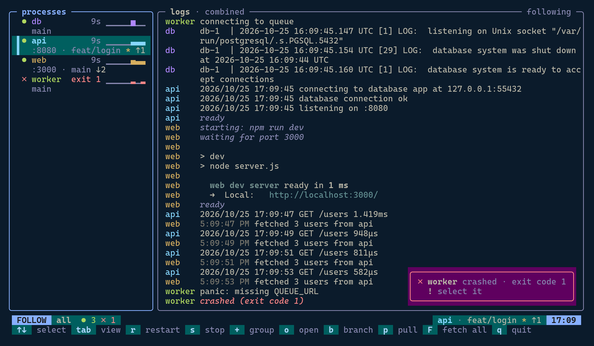
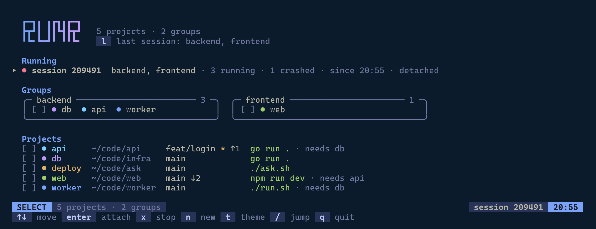
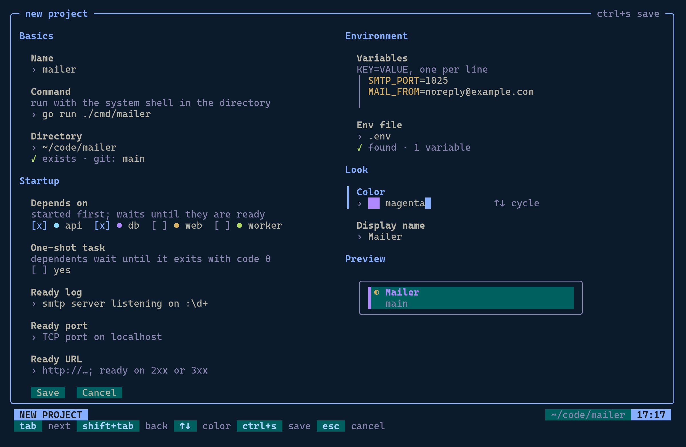
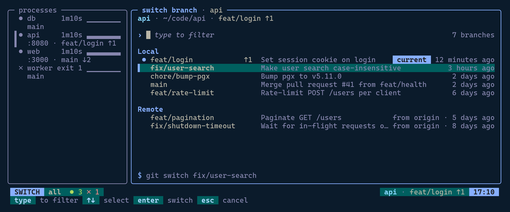
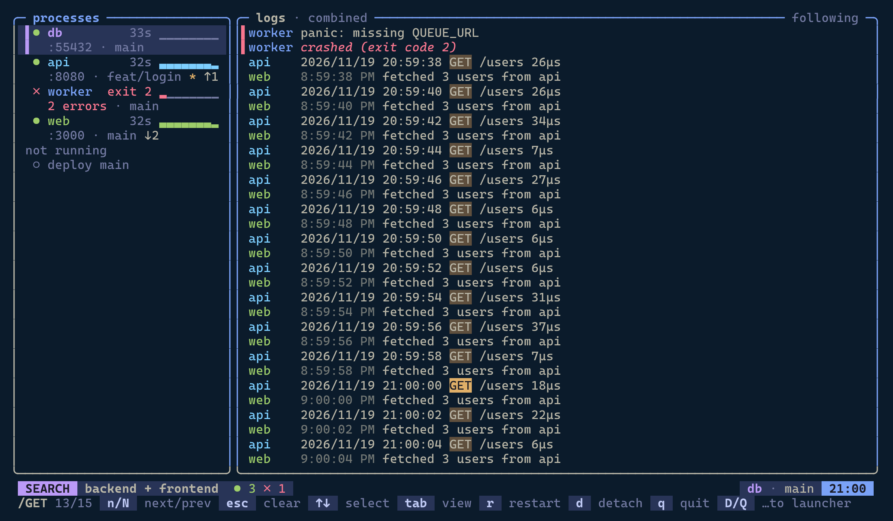

# runr

Run several local programs at once — a database, a few services, a frontend — and watch
all their output in one terminal UI.

You register each project once (directory + command), optionally put projects into named
groups, and then start any combination with one command. runr starts dependencies first,
waits until they are ready, interleaves everyone's output, and shuts everything down in
reverse order when you quit.



Works on Linux, macOS and Windows.

## Features

- **Dependencies and readiness:** projects start after what they depend on is ready — when
  a log line matches, a port or health URL answers, or a one-shot task (a migration,
  `npm install`) has finished.
- **Launcher:** pick groups and projects to start, and add or edit them in forms.
- **Running view:** every process with its state, uptime, ports and git branch; combined or
  per-process logs with search; restart, stop and start processes as you go.
- **Interactive programs:** run a project on a terminal (`pty = true`) and attach to it to
  answer its prompts, e.g. a script that asks for a branch name.
- **Shared configs:** write project directories as `$RUNR_ROOT/api`, so a team can share one
  config while everyone keeps their checkouts in a different place.
- **From another terminal:** `runr status`, `runr logs api --errors` and
  `runr restart api --wait` show and change what a running session is doing, so scripts and
  coding agents can restart a service and read a crash without copy-paste.
- **Git:** see each project's branch and changes, switch branches, fetch and pull all.
- **Import** projects from a `Procfile` or a Docker Compose file.
- **Logs** saved to files on demand or for every session, plain output when piped, and color
  themes.

## Screenshots

The launcher, where you pick what to start and manage projects and groups:



Adding a project: the form checks the directory and env file as you type and previews the
project's row:



Switching a project's git branch from the running view:



Searching the logs:



## Install

Download a binary from the [releases](https://github.com/Skaanning/runr/releases), or
build it with Go 1.27 or newer:

```bash
go install github.com/Skaanning/runr/cmd/runr@latest
```

This puts `runr` in `$(go env GOPATH)/bin`, usually `~/go/bin`; make sure that directory is
on your `PATH`. See [Building and releasing](docs/guide.md#building-and-releasing) for the
release binaries and building from a clone.

## Quick start

Register your projects. `--dir` defaults to the current directory; everything after `--`
is the command.

```bash
runr add db --dir ~/code/infra --ready-log 'listening on IPv4' -- docker compose up postgres
runr add api --dir ~/code/api --depends-on db --env PORT=8080 -- go run ./cmd/server
cd ~/code/web && runr add web --depends-on api -- npm run dev
```

Group them, if you like:

```bash
runr group create backend db api
```

Then start what you need:

```bash
runr up backend        # db first, api once db printed "listening on IPv4"
runr up web            # pulls in api and db automatically
runr                   # or pick from a list in the launcher
```

Press `q` to stop everything. See [examples/config.toml](examples/config.toml) for a
complete config file.

Already have a `Procfile` or `compose.yaml`? `runr import` registers all of it at once (see
[Importing](docs/guide.md#importing-a-procfile-or-compose-file)).

## Documentation

The [guide](docs/guide.md) covers everything else:

- [Commands](docs/guide.md#commands) and their flags
- [Configuration](docs/guide.md#configuration): settings, themes, project fields,
  [sharing a config](docs/guide.md#sharing-a-config)
- [The launcher](docs/guide.md#the-launcher) and [the running view](docs/guide.md#the-running-view), with all their keys,
  and [typing into a program](docs/guide.md#typing-into-a-program)
- [Saving logs](docs/guide.md#saving-logs), [talking to a running session](docs/guide.md#talking-to-a-running-session)
  and [Git](docs/guide.md#git)
- [How processes are run](docs/guide.md#how-processes-are-run) and
  [Troubleshooting](docs/guide.md#troubleshooting)

## License

MIT, see [LICENSE](LICENSE).
