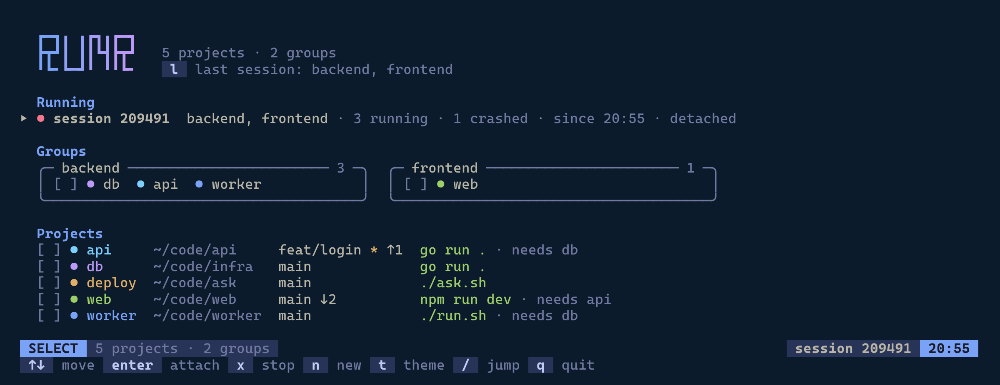
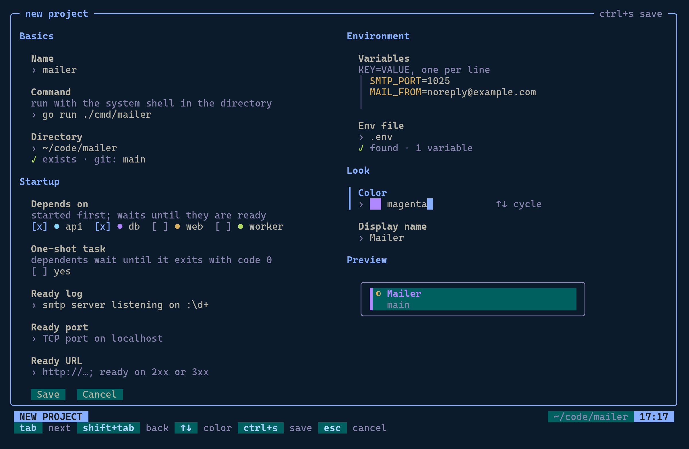
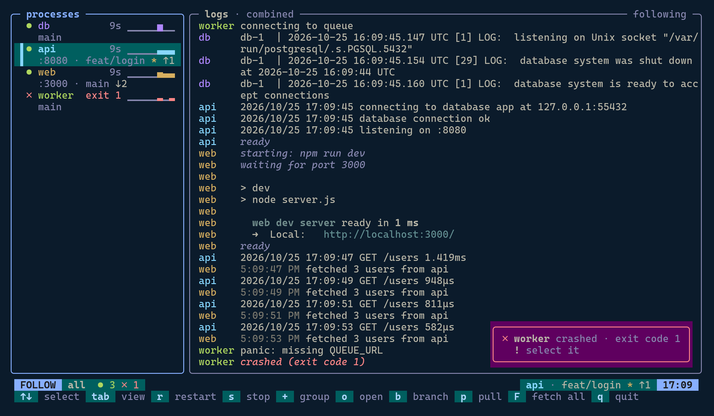
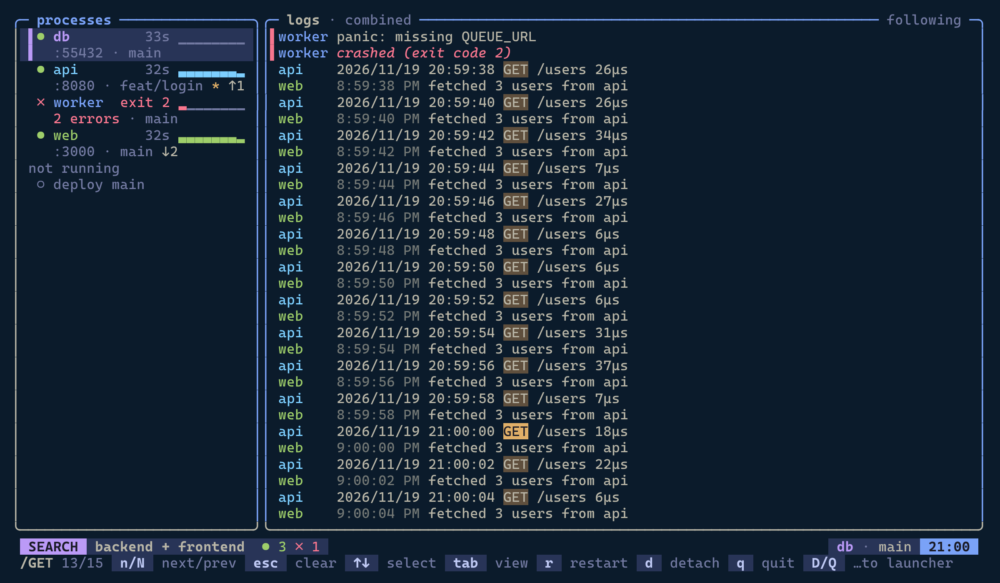
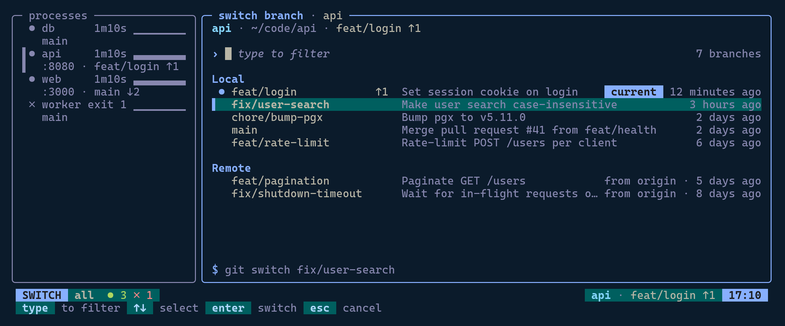

# runr guide

Everything about using runr. For a short introduction, see the [README](../README.md).

- [Commands](#commands)
- [Importing a Procfile or compose file](#importing-a-procfile-or-compose-file)
- [Configuration](#configuration): [settings](#settings), [themes](#themes),
  [project fields](#project-fields), [validation](#validation)
- [The launcher](#the-launcher)
- [The running view](#the-running-view): [errors](#errors)
- [Saving logs](#saving-logs)
- [Git](#git)
- [How processes are run](#how-processes-are-run)
- [Troubleshooting](#troubleshooting)
- [Building and releasing](#building-and-releasing)

## Commands

| Command | Description |
|---|---|
| `runr` | Open the launcher |
| `runr up <name...> [--log-dir <dir>]` | Start groups and/or projects (plus their dependencies) and open the running view; `--log-dir` also saves each project's output to `<dir>/<project>.log` (see [Saving logs](#saving-logs)) |
| `runr up --last` | Start what the last session started (including what you started later from the running view), with the same extra arguments. Projects or groups since removed are skipped with a warning |
| `runr add <name> [flags] -- <cmd>` | Register a project |
| `runr edit <name> [flags] [-- <cmd>]` | Change a project; only the given flags change |
| `runr rm <name> [--force]` | Remove a project (and from its groups); refuses if others depend on it unless `--force` |
| `runr rename <name> <new-name>` | Rename a project or group; groups and `depends_on` are updated |
| `runr ls` | List projects and groups, with warnings such as missing directories |
| `runr import [file\|dir] [flags]` | Register projects from a Procfile or Docker Compose file (see [Importing](#importing-a-procfile-or-compose-file)) |
| `runr group create <group> <project...>` | Create a group |
| `runr group add <group> <project...>` | Add projects to a group |
| `runr group rm <group> <project...>` | Remove projects from a group |
| `runr group delete <group>` | Delete a group (its projects are kept) |
| `runr group ls` | List groups |
| `runr theme [name]` | List the color themes (the current one marked with `*`), or set one |
| `runr cleanup [--yes]` | Stop processes left running by a runr that was killed (Linux, macOS); asks first unless `--yes` |
| `runr completion <shell>` | Shell completion script (bash, zsh, fish, powershell), completes project and group names |

Flags for `add` and `edit`:

| Flag | Field |
|---|---|
| `--dir <path>` | `dir` (`add`: defaults to the current directory) |
| `--env KEY=VALUE` | `env`, repeatable; `edit` sets/overrides single variables |
| `--unset-env KEY` | `edit` only: remove a variable, repeatable |
| `--env-file <path>` | `env_file` |
| `--depends-on <name>` | `depends_on`, repeatable or comma-separated; `edit` replaces the list, `--depends-on=` clears it |
| `--ready exit` | `ready` (`--ready=` clears it) |
| `--ready-log <regex>` | `ready_log` |
| `--ready-port <port>` | `ready_port` (`--ready-port=` clears it) |
| `--ready-url <url>` | `ready_url` |
| `--color <color>` | `color` |
| `--display-name <label>` | `display_name` |

With `edit`, a flag given an empty value (e.g. `--color=`) clears that field.

If `runr up` isn't connected to a terminal (piped, or run from a script), it prints the
interleaved output with a name prefix instead of opening the UI, and exits once all
processes have finished — with exit code 1 if any crashed. Ctrl+C stops everything. Unless
that output is a terminal (and `NO_COLOR` isn't set), it has no colors: the programs'
colors and other escape codes are removed too.

## Importing a Procfile or compose file

If a repository already has a `Procfile` or a `compose.yaml`, register all of it at once:

```bash
cd ~/code/shop && runr import     # finds Procfile, compose.yaml, compose.yml,
                                  # docker-compose.yaml or docker-compose.yml
runr up shop                      # the group named after the compose name or the directory
```

- **Procfile**: one project per `name: command` line, run in the file's directory. A `.env`
  next to it becomes the projects' `env_file`, as foreman and overmind would load it.
- **Compose**: one project per service, run as
  `docker compose [-f <file>] up --no-deps --no-log-prefix <service>`. `--no-deps` leaves
  starting the dependencies to runr, from `depends_on`. A service with a published TCP port
  gets that host port as `ready_port`. A service that another one waits for with
  `condition: service_completed_successfully` (a migration, say) becomes a one-shot task
  (`ready = "exit"`) instead; other conditions are ignored. Images, builds, environment and
  profiles stay in the compose file.
- `runr import <file>` imports a file of any name (`--format procfile|compose` if the name
  doesn't tell), `runr import <dir>` searches that directory.
- `--group <name>` names the group, `--no-group` skips it; `--prefix <p>` puts `<p>` in front
  of every project name. If a name is already taken, nothing is imported and the clashes
  are listed. `--dry-run` prints the TOML that would be added.
- It's a one-time copy: change the projects with `runr edit` afterwards, and re-import (e.g.
  after `runr rm`) if the file changes a lot.

## Configuration

Everything lives in one file:

| OS | Path |
|---|---|
| Linux | `~/.config/runr/config.toml` (or `$XDG_CONFIG_HOME/runr/config.toml`) |
| macOS | `~/Library/Application Support/runr/config.toml` |
| Windows | `%AppData%\runr\config.toml` |

Set `RUNR_CONFIG=/path/to/config.toml` to use a different file. The file is created on the
first change and is readable only by you, since `env` values may hold secrets.

You can edit it by hand, but `runr add`/`edit`, `runr group …` and the launcher's forms all
validate before saving and are usually easier. runr rewrites the whole file when it saves,
so **comments in a hand-edited file are lost** after the next change made through runr.

```toml
[settings]
shutdown_timeout = "5s"
scrollback_lines = 10000
show_all = true
theme = "tokyo-night"

[projects.api]
dir = "~/code/api"
cmd = "go run ./cmd/server"
env = { PORT = "8080" }
env_file = ".env"
depends_on = ["db", "migrate"]
ready_log = 'listening on :\d+'
color = "cyan"
display_name = "API"

[projects.migrate]
dir = "~/code/api"
cmd = "go run ./cmd/migrate"
ready = "exit"   # a one-shot task: api waits until it has finished

[groups]
backend = ["db", "api"]
```

### Settings

| Key | Default | Description |
|---|---|---|
| `shutdown_timeout` | `"5s"` | How long a stopping process gets before it is killed (Go duration: `500ms`, `10s`, `1m`) |
| `scrollback_lines` | `10000` | Lines of output kept per process |
| `theme` | `"terminal"` | Colors of the TUI: `terminal` (your terminal's own colors), `catppuccin`, `tokyo-night`, `gruvbox` or `nord`. See [Themes](#themes). |
| `theme_background` | `false` | Paint the theme's background and text color behind the whole TUI instead of letting your terminal's show through. See [Themes](#themes). |
| `show_all` | `true` | List the registered projects that aren't running in the running view's sidebar, below the session's (`a` toggles it for a session) |
| `log_dir` | — | Directory where every session appends each project's output to `<project>.log`, e.g. `"~/.local/state/runr/logs"`; `runr up --log-dir` overrides it (see [Saving logs](#saving-logs)) |
| `error_pattern` | `'(?i)\b(error\|panic\|fatal\|exception\|traceback)\b'` | The [regular expression](https://pkg.go.dev/regexp/syntax) that marks a line of output as an error (see [Errors](#errors)), matched without the line's colors |

### Themes

`terminal` uses your terminal's 16 colors, so runr matches whatever scheme the terminal has.
The others bring their own colors: `catppuccin` (mocha on dark terminals, latte on light
ones), `tokyo-night` (night / day), `gruvbox` (dark / light) and `nord` (dark only; on a
light terminal runr uses the `terminal` theme instead). runr asks the terminal whether its
background is light or dark when it starts, and assumes dark if it doesn't answer. Themes
color the text only and your terminal's background shows through, unless you set
`theme_background = true`: then runr sets the terminal's background and text color to the
theme's while it runs (so output that resets its colors falls back to the theme's too) and
restores them when it exits. That needs a terminal that answers the background query and lets
programs set its colors, which most do. Named project colors
(`cyan`, `bright-red`, …) come from the theme; numbers and hex codes are used as they are.
Themes need a 256-color or true-color terminal; with 16 colors runr uses the `terminal`
theme.

To try them, press `t` in the launcher: it shows each theme as you move through the list and
saves the one you pick. `runr theme` lists them and `runr theme <name>` sets one.

### Project fields

| Field | Required | Description |
|---|---|---|
| `dir` | yes | Working directory. `~` is expanded. |
| `cmd` | yes | Command line, run with `sh -c` (Unix) or `cmd /c` (Windows), so pipes, `&&` and variables work |
| `env` | no | Environment variables, e.g. `{ PORT = "8080" }` |
| `env_file` | no | A `.env` file, relative to `dir` (absolute and `~` paths work too) |
| `depends_on` | no | Projects that must be ready before this one starts |
| `ready` | no | `"exit"` makes the project a one-shot task (a migration, a build step, `npm install`): it is ready once it exits with code 0, so its dependents wait until it has finished, and a non-zero exit blocks them. |
| `ready_log` | no | Regular expression ([Go syntax](https://pkg.go.dev/regexp/syntax)); the project is ready once an output line matches. Colors are stripped before matching. |
| `ready_port` | no | TCP port; the project is ready once a connection to it on `localhost` succeeds, e.g. `5432` for a database. |
| `ready_url` | no | `http://` or `https://` URL; the project is ready once a GET answers with a 2xx or 3xx status (redirects aren't followed), e.g. `"http://localhost:8080/health"`. The probe's requests show up in the server's access log. |

A project has at most one of `ready`, `ready_log`, `ready_port` and `ready_url`. Without
any, it is ready as soon as it has started. Ports and URLs are tried every 250 ms (each try
times out after 1 s) for as long as the process runs; there is no overall time limit.
| `color` | no | Color of the name in the TUI: `black`, `red`, `green`, `yellow`, `blue`, `magenta`, `cyan`, `white`, their `bright-` variants (`bright-red`, …), an ANSI number `0`–`255`, or a hex code `#f80` / `#ff8800`. Projects without one get a color from a fixed palette, in name order, so a project has the same color in the launcher and every session. |
| `display_name` | no | Label shown in the TUI instead of the project name |

Names of projects and groups may contain letters, digits, `.`, `_` and `-` (starting with a
letter or digit), and share one namespace so `runr up <name>` is never ambiguous.

### Validation

runr checks the config when it loads it and before every save:

- group members and `depends_on` entries must exist, and dependencies can't form a cycle
  (reported as e.g. `api → auth → api`)
- at most one readiness condition per project; `ready` must be `"exit"`, `ready_log` a
  valid regex, `ready_port` a port 1–65535, `ready_url` an `http(s)://` URL with a host;
  `color` a known color
- `dir` and `env_file` should exist — only a warning in `runr ls` and the forms, but
  `runr up` refuses to start a project whose directory is missing

## The launcher

`runr` without arguments lists your groups and projects. Select some and press `enter` to
start them in the running view, or manage the registry with in-TUI forms. Groups are shown as
cards with a colored dot per member, side by side as far as the terminal is wide; projects
are listed below them with their color, directory, branch, command and dependencies.



The bottom line is the status bar: what the launcher is doing (`SELECT`, `NEW PROJECT`,
`SWITCH`, …), how much is registered and selected, and the project under the cursor with its
branch. On terminals shorter than 20 rows the `runr` mark makes room for the list.

| Key | Action |
|---|---|
| `↑` `↓`, `home` `end` | Move: through the group cards row by row, then down the project list |
| `←` `→` | Move between the group cards in a row |
| `space` | Select / unselect; on a group, selects all its projects (or unselects them if all are selected) |
| `enter` | Start the selection, or the item under the cursor if nothing is selected |
| `l` | Start the last session again, like `runr up --last`. Under the `runr` mark the launcher shows what that is: `l  last session: backend, web` |
| `R` | Start with extra arguments: like `enter`, but first a form with a field per project that will start, dependencies included. What you type is added to the end of the project's command, e.g. `--port 3001` makes `go run .` run as `go run . --port 3001`. The fields start with what you typed last, also in an earlier session. `shift+enter` does the same in terminals that report it (kitty, ghostty, WezTerm, foot, recent Windows Terminal) |
| `/` | Jump: every group and project shows a letter (`a`–`z`, then `A`–`Z`). A group's letter starts that group; a project's letter selects or unselects it and stays in jump mode, so you can pick several and press `enter` to start them. `esc` or `/` leaves |
| `n` | New project |
| `e` | Edit the project (or group) under the cursor; changing the name renames it |
| `g` | On a group: edit it. On a project: create a group, preselecting the selected projects |
| `d` | Delete, after confirmation that lists the affected groups and dependents |
| `b` | Switch the git branch of the project under the cursor (see [Git](#git)) |
| `p` | Pull the git repository of the project under the cursor (`git pull --ff-only`), after confirming |
| `F` | Fetch the git repositories of all registered projects |
| `P` | Pull the git repositories of the selection, or of the group or project under the cursor, after confirming |
| `c` | Copy the command line that starts the project under the cursor the way runr does: `cd` to its directory, runr's default variables, its `env_file` and `env`, then the command, e.g. `cd ~/code/api && env FORCE_COLOR=1 … PORT=8080 /bin/sh -c 'go run .'` (`cmd.exe` syntax on Windows). It goes to the clipboard through the terminal (OSC 52; in tmux, `set-clipboard on`) and is shown on the bottom line |
| `t` | Pick a color theme; the launcher previews the theme under the cursor, `enter` saves it, `esc` keeps the old one |
| `q`, `esc` | Quit |



In forms: `tab`/`enter` next field, `shift+tab` back, `←→` and `space` pick
dependencies or group members, `↑↓` on the color cycles through the named colors, `enter` in
the environment starts a new line. `ctrl+s` saves from any field, `esc` cancels. Errors show
under their field once you've edited or left it, and are counted in the status bar; the form
can't be saved until they are fixed. The directory and env file are checked as you type
(`✓ exists · git: main`), and a preview shows the project's row as the running view will.

In the directory field, the first folder matching what you've typed shows faint after the
cursor; `→` at the end of the line accepts it (hidden folders show once you type a `.`).
`ctrl+o` opens a folder browser at the directory typed (or the nearest folder above it that
exists): type to filter, `enter` opens a folder, `backspace` goes up, `ctrl+o` uses the folder
shown and `esc` goes back to the form. Git repositories are marked `git`. Quotes around a
directory or env file are dropped, so a path from Explorer's "Copy as path" can be pasted
as is.

## The running view



The `processes` pane gives each process two lines: its state, how long it's been running
(or `exit 1` in red once it crashed) and a sparkline of its output over the last 32 seconds,
then the ports it listens on and its git branch underneath (`:5173 +1 · main`: port 5173
and one more). On narrow terminals the sparkline goes first, then the uptime, and the
branch is shortened. The `logs` pane shows their output — either all of them interleaved (the
combined view) or just the selected one — with `following`, or `paused · 12 more below` once
you scroll up, in its border. The status bar below shows the mode (`FOLLOW`, `PAUSED`,
`SEARCH`, `STOPPING`, …), the session, how many processes are running, starting and failed,
the selected project's branch and the time. Terminals smaller than 50×10 get a compact
layout without the pane borders.

Below the session's processes, under `not running`, the `processes` pane lists the other
registered projects, dimmed; select one and press `s` or `enter` to start it (with its
dependencies). Turn that list off with
`show_all = false` in `[settings]`, or toggle it for a session with `a`. When something
crashes or is blocked, or a port it needs is taken, a toast in the corner of the output says
so for 5 seconds.

| Icon | State |
|---|---|
| `○` | pending |
| `⠋` (spinning) | waiting for dependencies, or started but not ready yet (its `ready_log` hasn't matched, its port or URL doesn't answer yet, or a one-shot task is still running); faint while stopping |
| `●` | running (ready) |
| `✓` | exited with code 0 (`done` for a one-shot task) |
| `✗` | crashed — the exit code is shown next to it |
| `■` | stopped by you |
| `⊘` | blocked: a dependency ended before it became ready |

| Key | Action |
|---|---|
| `↑` `↓` | Select a process |
| `tab` | Toggle between the combined view and the selected process's output |
| `r` | Restart the selected process |
| `R` | Restart the selected process with extra arguments, added to the end of its command; the input starts with its current ones, and an empty one removes them. They are kept for later restarts and shown in the title of the project's own log |
| `s` | Stop the selected process, or start it (with its dependencies) if it isn't running |
| `enter` | Start the selected project if it's one of those not running |
| `+` | Start a group, or another project when the sidebar doesn't list them all (type to filter, `enter` to start, `esc` to close) |
| `a` | Show or hide the projects that aren't running |
| `!` | Select the project of the newest toast |
| `o` | Open the selected process's port (`http://localhost:<port>`) in the browser; asks which one when it listens on several |
| `b` | Switch the selected project's git repository to another branch (see [Git](#git)) |
| `p` | Pull the selected project's git repository (`git pull --ff-only`), after confirming |
| `F` | Fetch the git repositories of every project in the session |
| `P` | Pull the git repositories of every project in the session, after confirming |
| `/` | Search the output; `enter` jumps to the newest match, `esc` cancels |
| `n` / `N` | Next newer / older match |
| `e` / `E` | Jump to the next newer / older error line (see [Errors](#errors)) |
| `esc` | Clear the search and the error position |
| `PgUp` / `PgDn` | Scroll a page |
| `g` / `G` (`home` / `end`) | Jump to the top / bottom |
| `f` | Toggle follow (auto-scroll); scrolling to the bottom resumes it |
| `w` | Save the output on screen (all of it, or the selected process's) to a file in the current directory (see [Saving logs](#saving-logs)) |
| `c` | Copy the command line that starts the selected project the way runr does (with its extra arguments, if it has any): `cd` to its directory, runr's default variables, its `env_file` and `env`, then the command, e.g. `cd ~/code/api && env FORCE_COLOR=1 … PORT=8080 /bin/sh -c 'go run .'` (`cmd.exe` syntax on Windows). It goes to the clipboard through the terminal (OSC 52; in tmux, `set-clipboard on`) and is shown on the bottom line |
| `q`, `Ctrl+C` | Stop everything and quit; a second `Ctrl+C` kills everything immediately |

Search is plain text (no regex) and smart-case: an all-lowercase query ignores case, any
uppercase letter makes it case-sensitive.

### Errors

runr marks the lines of output that look like errors: those containing `error`, `panic`,
`fatal`, `exception` or `traceback` as a word, in any case (`no errors` and `terror` don't
count). A red `▌` sits left of each of them, and the process's second line in the sidebar
says how many its current run printed, e.g. `3 errors`; the count starts again at every
restart.

`e` jumps to the next error line in the log you're looking at (all processes, or the
selected one), `E` to the previous one, wrapping around at either end. The line jumped to
gets a yellow `▌`, scrolling stops, and the bottom line shows where you are, e.g.
`error 2/7`; `esc` clears it and `G` scrolls back to the newest output.

To match something else, set `error_pattern` in `[settings]`, e.g.
`error_pattern = '\b(ERROR|FATAL)\b'` for upper-case log levels only. runr's own lines
(`starting: …`, `crashed …`) are never counted.



runr adds its own lines to each process's log, such as `starting: <cmd>`,
`waiting for db`, `ready` and `crashed (exit code 1)`, so you can see what happened when.

## Saving logs

- **`w`** in the running view writes the output on screen — the combined view, or the
  selected process's — to `runr-<project|combined>-<YYYYMMDD-HHMMSS>.log` in the directory
  you started runr from. It holds what runr still has in memory (`scrollback_lines` per
  process), including runr's own lines (`starting: …`, `crashed …`).
- **`--log-dir <dir>`** (or `log_dir` in `[settings]`) keeps everything: each project's
  output is appended to `<dir>/<project>.log` as it arrives, written to disk at least once a
  second, so a crash leaves its last lines behind. Each session starts with a
  `--- runr session 2026-10-25 13:27:50 ---` line. The directory is created if needed; files
  are never rotated or deleted by runr. If a file can't be written, the project's log says
  so and runr stops saving its output there. Works with the launcher and with plain output
  too.

Both are plain text without colors, one line per output line:

```
13:27:52.145 » starting: go run .
13:27:52.204 │ 2026/10/25 13:27:52 database connection ok
```

Saved combined logs put the project's name before `│` / `»`; `»` marks runr's own lines.

## Git

When `git` is installed, the sidebar (on each process's second line) and the launcher show
the branch of the repository each project's `dir` is in, with markers:

```
│ ▌● api     4m02s ▁▂▃▅▃▂▁▂ │
│ ▌  feat/login * ↓2        │
│  ● web     3m58s ▁▁▂▁▁▂▁▁ │
│    main ↑1                │
│  ✗ worker exit 1 ▁▁▁▁▁▃▇▁ │
│    (a1b2c3d) !            │
```

| Marker | Meaning |
|---|---|
| `*` | uncommitted changes to tracked files (staged or unstaged) |
| `↑n` / `↓n` | commits ahead of / behind the upstream, as of the last fetch or pull |
| `!` | a merge, rebase, cherry-pick, revert or `git am` in progress, or unresolved conflicts |
| `(a1b2c3d)` | detached HEAD |
| `?` (faint) | the state can't be read, e.g. git refuses the directory ("dubious ownership") |

Projects outside a repository show nothing. The state is read every 5 seconds and after
each action; runr never fetches on its own — press `F` to update `↑n` / `↓n`.



`b` (switch branch) and `p` (pull) work in the launcher and the running view. They act on the
selected project's repository, and only in the simple cases — anything that needs a decision
is left to you:

- Both are refused up front while the repository has uncommitted changes to tracked files,
  unresolved conflicts, or an operation in progress. Untracked files don't count, but git
  still refuses to overwrite them.
- `b` lists local branches and remote branches without a local one (most recent first),
  each with how far it is ahead/behind its upstream (`↑2 ↓1`), its last commit's subject and
  date; picking a remote branch creates a local branch that tracks it. The bottom of the list
  shows the git command `enter` runs. Type to filter; the matching part is highlighted.
- `p` fast-forwards the current branch from its upstream and fails if the branch has
  diverged — runr never merges, rebases, stashes or resets. It is refused on a detached
  HEAD or a branch without an upstream.
- If other projects are in the same repository, the picker (`also switches: …`) or the
  confirmation says so,
  since they change too (in the launcher: any registered project; in the running view:
  projects in the session).
- In the running view, git's output goes to the selected project's log, and a short summary
  or error to the bottom line. In the launcher, git's output is shown when it fails. Running processes are not restarted; press `r` if your dev server doesn't
  reload by itself.

`F` and `P` do the same for every repository at once — in the running view those of the
session's projects; in the launcher `F` covers all registered projects and `P` the selection
(or the group or project under the cursor):

- `F` runs `git fetch` in each repository, four at a time, then reads the state again, so
  the `↑n` / `↓n` markers are current. The bottom line sums it up (`fetched 3 repos ·
  1 failed`); failures go to the projects' logs (in the launcher: shown in place of the
  list).
- `P` asks first, listing the repositories (`Pull 2 repos? infra (db) · app (api, worker)`),
  then pulls them one at a time like `p`. Repositories that `p` would refuse (uncommitted
  changes, no upstream, …) are skipped, not fatal. The bottom line sums it up (`pulled 2 ·
  up to date 1 · skipped 1`), with the details in each project's log (in the launcher: the
  skipped and failed ones in place of the list).
- git never prompts: it gets no input, credential prompts are off and `ssh` runs in
  batch mode, so a pull that needs a password or passphrase fails instead of hanging — use
  an SSH agent or a credential helper. A `GIT_SSH_COMMAND` of your own is used as is; a
  `core.sshCommand` too, with `-o BatchMode=yes` added when it runs `ssh`. Each git command
  times out after 60 seconds.

## How processes are run

- **Dependencies.** Starting a project starts everything in its `depends_on`, transitively.
  Independent projects start in parallel; a project starts once all its dependencies are
  ready. Without a readiness condition, a project is ready as soon as it has started — so
  give a migration or build step `ready = "exit"`: its dependents then wait until it exits
  with code 0. If a dependency exits or crashes *before* it was ready, its dependents are
  blocked (`⊘`); restarting the dependency unblocks them. A crash *after* it was ready leaves
  dependents running. Restarting a finished one-shot task runs it again without restarting
  the projects that depend on it.
- **Environment**, later entries win: runr's own environment → `FORCE_COLOR=1`,
  `CLICOLOR_FORCE=1`, `PYTHONUNBUFFERED=1` → `env_file` → `env`.
- **Output** is read from pipes, not a terminal. The variables above get most tools to keep
  colors and not buffer their output; tools that ignore them may print without colors or
  in bursts. Processes get no input (stdin is empty). Lines longer than 64 KiB are split.
- **Stopping** (`s`, `r`, `q`): each process and everything it started gets SIGTERM
  (`CTRL_BREAK` on Windows) and `shutdown_timeout` to exit before it is killed. On quit,
  projects stop in reverse dependency order: dependents first, then what they depend on.
- **Processes left behind.** If a command exits but something it started keeps running in
  the background, runr stops that too (on Unix it gets SIGTERM and `shutdown_timeout`
  first). Programs that fully detach themselves (daemons) are not affected.
- runr never restarts a process on its own.
- **If runr itself is killed** (`kill -9`, a crash, a closed terminal that doesn't send
  SIGHUP), the programs it started keep running on Linux and macOS. runr keeps a small file
  per session listing them (in `~/.local/state/runr/sessions`, or under `$XDG_STATE_HOME`; on
  macOS `~/Library/Caches/runr/sessions`), so the next `runr` or `runr up` asks first:
  `Kill 2 processes left over from a previous runr session? api (pid 4123), db (pid 4120)`.
  `enter`/`y` stops them like a normal shutdown, `esc`/`n` leaves them running and doesn't
  ask again. `runr up` starts your projects only after you've answered; with plain output it
  just prints a warning. `runr cleanup` does the same from the command line. Process start
  times are checked, so a process that merely got the same pid is never touched. On
  Windows, programs end with runr anyway.
- **Ports** shown in the `processes` pane are the TCP ports the project's processes listen
  on, including ones opened by programs it started (e.g. `npm run dev` → `node`). They are
  checked every 2 seconds. On macOS this needs `lsof` (installed by default). Press `o` to
  open one in the browser.
- **Port conflicts.** When a project starts, runr checks the ports it is known to use — its
  `ready_port`, the port of its `ready_url`, and ports it listened on earlier in the
  session — and if another program already listens there, says so in its log and in a toast
  (`port 3000 is in use by pid 4123 (python3)`). The project is started anyway.

## Troubleshooting

- **No colors, or output arrives late:** the program thinks it isn't writing to a terminal.
  Look for a flag or variable that forces colors / line buffering (e.g. `--color=always`)
  and add it to `cmd` or `env`.
- **`stopped (signal: terminated)` although the program shut down cleanly:** wrappers like
  `go run` report the signal rather than the program's own exit code. So does the shell on
  systems where `/bin/sh` is dash (Debian, Ubuntu): it doesn't replace itself with the
  command, and stops on SIGTERM before the program does. Harmless (the program still gets
  `shutdown_timeout`); start `cmd` with `exec` to see the program's own status.
- **npm prints an update notice when stopping:** add
  `--env NPM_CONFIG_UPDATE_NOTIFIER=false`.
- **`theme_background = true` has no effect:** the terminal didn't answer runr's question
  about its background color (inside tmux this happens when tmux doesn't know the outer
  terminal's colors), or it ignores programs setting its colors. The theme is still used for
  the text. With 16 colors, and with the `terminal` theme, nothing is painted.
- **The terminal kept runr's background after runr was killed:** runr restores the colors when
  it exits, but not when it's killed with `SIGKILL`. Run `reset`, or
  `printf '\e]110\a\e]111\a'`.
- **A project's spinner keeps spinning:** it is waiting for a dependency, or its `ready_log` hasn't
  matched, or its `ready_port`/`ready_url` doesn't answer (wrong port, or the server listens
  on another address than `localhost`). Select it and press `tab` to see its log; runr's lines say what it's waiting for.

## Building and releasing

```bash
git clone https://github.com/Skaanning/runr.git && cd runr
go install ./cmd/runr        # or: make build → bin/runr
make cross                   # binaries for Linux, macOS and Windows in dist/
```

Release binaries are named `runr-<os>-<arch>`, with their SHA-256 sums in `checksums.txt`.
Rename yours to `runr` (`runr.exe` on Windows), make it executable (`chmod +x runr`) and put
it on your `PATH`. On macOS the binaries aren't signed: remove the quarantine flag with
`xattr -d com.apple.quarantine runr`.

To release, push a tag like `v0.1.0`: `.github/workflows/release.yml` builds the binaries
with `make cross` and publishes them as a GitHub release.
